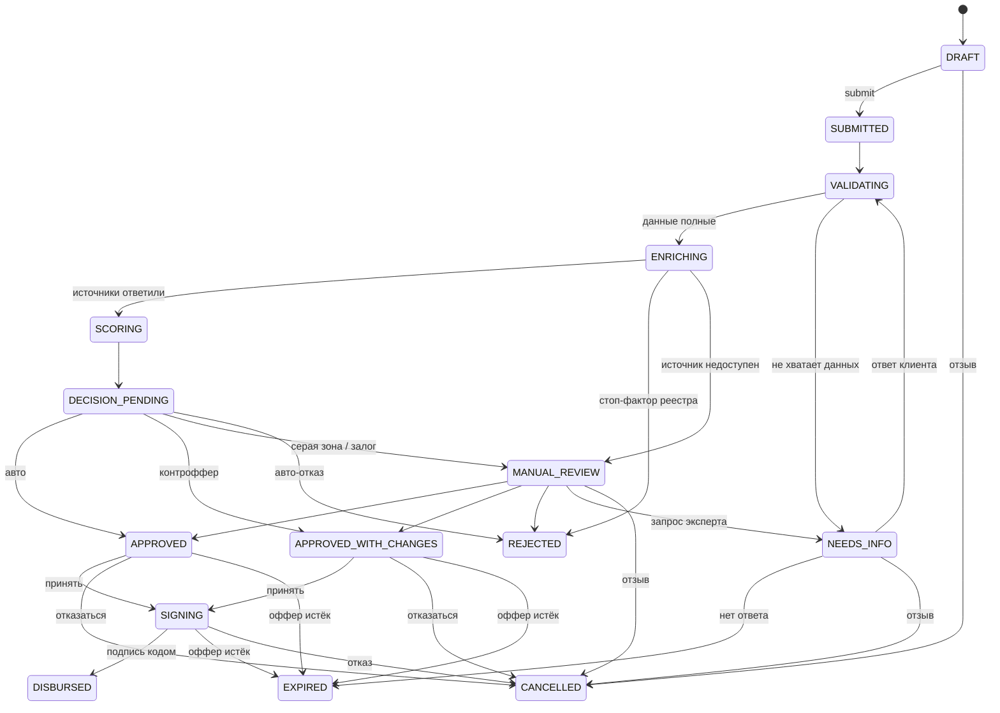

# Умный кредитный кабинет предпринимателя

Прототип цифрового кредитного конвейера для малого и микробизнеса: предприниматель проходит путь от потребности в деньгах до выдачи кредита в одном веб-кабинете, а банк обрабатывает заявку в том же процессе — с автоматической проверкой, скорингом, ручным рассмотрением серой зоны и журналом аудита.
Хакатон «Альфа-Будущее» · кейс Альфа-Банка и Changellenge >> · версия для проверки: **`v1.0-hackathon`** (commit: `<hash>` — заполняется при теге).

> Все данные синтетические. Подписание и выдача — имитация. Внешние сервисы (ЕГРЮЛ/ЕГРИП, «Прозрачный бизнес», БКИ) — локальные моки.

## 1. Назначение
В реестре МСП 6,6 млн компаний и ИП (10.07.2026, +3,5% г/г), банки выдали субъектам МСП 1,313 трлн ₽ кредитов (июль 2026), объём выдач малому бизнесу Альфа-Банка превысил 1 трлн ₽ (октябрь 2025). При этом для предпринимателя кредит — это «чёрный ящик»: непонятно, какой продукт подходит, что нужно банку и что происходит с заявкой. Прототип связывает клиентский путь и внутреннюю обработку заявки в один управляемый процесс с единым статусом и объяснимым решением.

## 2. Проблема и пользователи
Пользователи — собственник, гендиректор, бухгалтер или уполномоченный сотрудник компании; на стороне банка — кредитный эксперт и администратор. Топ-боли клиента: не понимает разницу продуктов, вводит одни и те же данные, не знает статус заявки, получает отказ без объяснения. Топ-боли банка: ручной разбор каждой заявки, неполные данные, данные разбросаны по системам, нет прозрачности решений для аудита. Подробно: [docs/product/01_research.md](docs/product/01_research.md).

## 3. Что умеет прототип
1. Подбирает продукт по цели финансирования и считает платёж до заявки.
2. Заполняет реквизиты компании по ИНН из реестра и сохраняет черновик анкеты.
3. Показывает живой таймлайн из 6 шагов с блоком «Что дальше» — без перезагрузки страницы.
4. Запрашивает недостающие документы и уточнения прямо в кабинете.
5. Оценивает заявку прозрачной скоринговой картой и выдаёт одно из 5 решений: одобрено, одобрено с изменениями, другой продукт, запрос информации, отказ — с объяснением простыми словами.
6. Передаёт серую зону эксперту: очередь с SLA, единая карточка (анкета, реестры, кредитная история, скоринг, документы), решение с комментарием.
7. Завершает путь внутри продукта: подпись кодом на экране, график платежей.
8. Показывает персональную новостную ленту, которая меняется от отрасли, роли и стадии заявки, с объяснением «Почему я это вижу».
9. Пишет каждый переход в журнал аудита.

## 4. Границы MVP
> **Вошло:** мастер подбора, калькулятор, анкета с автозаполнением по ИНН и черновиком, документы по чек-листу, живой таймлайн, запрос и дозагрузка информации, скоринг на правилах с объяснением, 5 исходов решения, ручное рассмотрение, подписание кодом на экране, график платежей, персональная лента, журнал аудита.
> **Имитировано:** ЕГРЮЛ/ЕГРИП, «Прозрачный бизнес», БКИ, внутренние данные банка, подписание, выдача — локальный сервис моков с детерминированными ответами.
> **Не вошло:** реальные интеграции и ЭЦП, ML-скоринг, кредитный комитет, email/SMS/мессенджеры, мобильное приложение, обслуживание кредита.
> **ИИ:** опционально (`LLM_ENABLED`, только open-weights), объясняет решение простыми словами; при выключении работает шаблон, сценарий не меняется.

Продукты: «Экспресс-оборотка» (0,3–5 млн ₽, без залога), «Инвест-кредит» (1–30 млн ₽, залог — покупаемое имущество), «Кредитная линия» (0,5–15 млн ₽). Условия синтетические. Подробно и почему: [docs/product/02_mvp_scope.md](docs/product/02_mvp_scope.md).

## 5. Процесс и state machine
15 статусов, 24 перехода; любой переход вне таблицы → `409 INVALID_TRANSITION`. Полная таблица переходов и тексты для клиента: [docs/process/state_machine.md](docs/process/state_machine.md).



## 6. Логика решения
1. **Стоп-факторы** (ликвидация, текущая просрочка > 90 дней, бизнес < 3 мес., дисквалификация руководителя) — отказ независимо от баллов.
2. **Скоринг** — 500 баллов ± 9 факторов (срок, выручка, динамика, долговая нагрузка, кредитная история, запросы в БКИ, отрасль, расхождения с реестром, клиент банка) → класс риска A–D. Не зависит от продукта.
3. **Кредитная политика продукта** — по классу, сумме и нагрузке выбирает исход и при необходимости подбирает контроффер: сначала сохраняет сумму (срок → другой продукт), потом уменьшает её.
4. Клиент видит топ-3 фактора без баллов, эксперт — все факторы и версию правил. Правила — конфиг [`config/scoring_rules.yaml`](config/scoring_rules.yaml).
Подробно и расчёты по тестовым компаниям: [docs/process/scoring_and_decision.md](docs/process/scoring_and_decision.md).

## 7. Архитектура *(dev)*
<!-- DEV: схема компонентов (docs/architecture/architecture.md), выбранный стек и обоснование. -->
Рекомендация PM к компонентам: `web` (SPA) · `api` (REST, JWT, RBAC) · `worker` (автоматический конвейер, таймеры) · `db` (PostgreSQL) · `storage` (MinIO / том) · `mocks` (ЕГРЮЛ/ЕГРИП, «Прозрачный бизнес», БКИ, внутренние данные) · `llm` (Ollama, опционально, профиль `ai`). Модель данных: [docs/architecture/data_model.md](docs/architecture/data_model.md).

## 8. Требования к окружению и запуск *(dev)*
<!-- DEV: версии Docker/Compose, языка и ключевых библиотек; lock-файлы; порты; ресурсы. -->
- Docker 24+ и Docker Compose v2; 4 ГБ RAM (8 ГБ с профилем `ai`); интернет нужен только для скачивания образов.
- Запуск: `cp .env.example .env && docker compose up -d` → клиент `http://localhost:3000`, API `http://localhost:8080/api/v1`, Swagger `http://localhost:8080/api/docs`, моки `http://localhost:8090`.
- С ИИ: `docker compose --profile ai up -d` и `LLM_ENABLED=true`.

## 9. Переменные окружения

| Переменная | По умолчанию | Назначение | Владелец |
| --- | --- | --- | --- |
| `DEMO_MODE` | `true` | Список тестовых учёток на входе, сброс демо, управление режимами моков | PM |
| `DEMO_STEP_DELAY_MS` | `3000` | Видимая пауза между автоматическими шагами конвейера (`0` в CI) | PM |
| `SEED_ON_START` | `true` | Пересоздать демо-данные при старте | PM |
| `LLM_ENABLED` | `false` | Включить объяснения на open-weights модели | PM |
| `LLM_MODEL` | `qwen2.5:7b-instruct` | Модель в Ollama (Apache-2.0); на слабом ПК — `qwen2.5:1.5b-instruct` | dev |
| `OFFER_TTL_MINUTES` | `14400` (10 дн.) | Срок действия оффера | PM |
| `INFO_REQUEST_TTL_MINUTES` | `20160` (14 дн.) | Срок ответа на запрос информации | PM |
| `SOURCE_RETRIES` / `SOURCE_TIMEOUT_MS` | `3` / `3000` | Ретраи и таймаут запросов к источникам | PM + dev |
| `JWT_SECRET`, `DATABASE_URL`, `STORAGE_*`, `MOCKS_URL` | — | Инфраструктура | dev |

## 10. Тестовые учётки и данные
Пароль у всех: `Demo2026!` (демонстрационный; в базе — только bcrypt-хэш).

| Логин | Роль | Компания | Сценарий |
| --- | --- | --- | --- |
| anna@demo.local | Клиент, собственник | ИП «Кофейня Зерно» (C1) | Главный путь: запрос информации → контроффер → выдача |
| igor@demo.local | Клиент, гендиректор | ООО «ТрансЛогистик» (C2) | Авто-отказ с объяснением |
| marina@demo.local | Клиент, бухгалтер | ООО «Мебельная мастерская» (C3) | Ручное рассмотрение, залог |
| sidorov@demo.local | Клиент | C4–C7 | Запрос эксперта, ликвидированная компания, сбой БКИ, другой продукт |
| expert@demo.local | Кредитный эксперт | — | Очередь и решения |
| admin@demo.local | Администратор | — | Журнал аудита, сброс демо |

Компании, ИНН и ожидаемые исходы: [docs/testing/test_data.md](docs/testing/test_data.md). Пересчитать ожидания: `python3 tools/reference/expected_outcomes.py`.

## 11. Как проверить за 10 минут
1. `git checkout v1.0-hackathon && cp .env.example .env && docker compose up -d`
2. `http://localhost:3000` → **anna@demo.local**: «Получить финансирование» → «Пополнить оборотные средства», 4 000 000 ₽, 12 мес. → «Экспресс-оборотка» → ИНН `001588139913` → финансы: выручка 18 000 000 / 17 000 000, расходы 1 150 000, платежи по кредитам 200 000 → **без декларации** → отправить.
3. Смотреть таймлайн: «Нужны уточнения» → загрузить `seed/documents/tax_return_2025_C1.pdf` → решение «Можем предложить другие условия: 3 000 000 ₽» → принять → код с экрана → «Кредит выдан».
4. **marina@demo.local**: «Купить оборудование», 12 000 000 ₽, 48 мес., ИНН `0068151888` → два документа из `seed/documents/` → отправить. **expert@demo.local**: очередь → карточка → «Одобрить».
5. **igor@demo.local**: «Экспресс-оборотка» 5 000 000 ₽, ИНН `0091141704` → отказ с причинами; сравнить ленту igor с лентой anna, нажать «Почему я это вижу?».
6. **admin@demo.local**: журнал аудита заявки anna. Swagger: `http://localhost:8080/api/docs`.
Все сценарии с ожидаемыми результатами: [docs/testing/test_scenarios.md](docs/testing/test_scenarios.md).

## 12. API
REST + JSON, `/api/v1`, JWT. Swagger UI: `/api/docs`; спецификация: `docs/api/openapi.yaml`; обзор контракта и примеры: [docs/api/api_overview.md](docs/api/api_overview.md); коллекция Bruno: [docs/api/collection/](docs/api/collection/README.md).

```http
GET /api/v1/companies/lookup?inn=001588139913        → реквизиты из [MOCK ЕГРЮЛ/ЕГРИП]
POST /api/v1/applications/{id}/submit                 → 202, status SUBMITTED (Idempotency-Key)
GET /api/v1/applications/{id}/offer                   → оффер, «вы просили / мы предлагаем», объяснение
```

## 13. Смоделированные интеграции и допущения
ЕГРЮЛ/ЕГРИП, «Прозрачный бизнес», БКИ и внутренние данные банка — сервис `mocks` с ответами из `seed/mock_*.json`; подписание — код на экране; выдача — создание кредита и графика без движения средств. Условия продуктов, веса скоринга, тексты ленты — синтетические и не отражают условия АО «Альфа-Банк». Полный перечень: [THIRD_PARTY_NOTICES.md](THIRD_PARTY_NOTICES.md); решения и отклонения: [docs/product/05_decisions.md](docs/product/05_decisions.md).

## 14. Enterprise-аспекты
- **Безопасность:** JWT + RBAC на каждом эндпоинте; клиент видит только свои компании; bcrypt; валидация типа и размера файлов; клиентские DTO без внутренних данных скоринга; только синтетические данные.
- **Надёжность:** конечный автомат с запретом недопустимых переходов; идемпотентность изменяющих запросов; optimistic locking по `version`; ретраи источников с фолбэком в ручное рассмотрение; таймеры истечения.
- **Аудит:** append-only журнал всех переходов с инициатором; версия правил в каждом скоринге; автор и комментарий каждого решения эксперта.
- **Масштабирование:** stateless API; конвейер — отдельный воркер; правила скоринга и ленты — конфиг; моки заменяются адаптерами по тем же контрактам.
- **Наблюдаемость:** `traceId` в ответах и логах; `/health`, `/ready`.

## 15. Ограничения и roadmap
Ограничения: балльная карта вместо валидированной модели; один эксперт без лимитов полномочий; моки вместо реальных источников; самодекларируемые финансы; подписание без юридической силы.
Roadmap: реальные интеграции ФНС и БКИ → ML-скоринг с валидацией (различающая способность, стабильность) поверх тех же контрактов → КЭП → кредитный комитет и лимиты полномочий → приглашение бухгалтера и мультикомпании → CMS и A/B-тесты ленты → OCR документов.

## 16. Версия для проверки
Тег `v1.0-hackathon`, commit `<hash>`. Для приватного репозитория доступ выдан аккаунту жюри `alfa-hack-2026`. Облачный стенд: `<url>` (необязателен; основная проверка — локальный Docker).

---
Документация продукта: [docs/](docs/product/traceability.md) — матрица трассировки требований кейса и критериев жюри.
