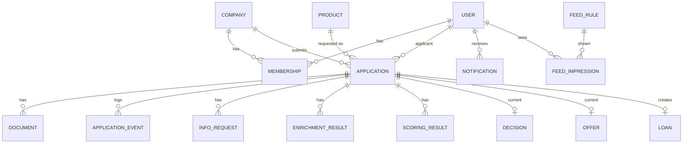

# Модель данных (D11, часть 2)
Статус: готов к ревью dev · Версия: 1.0 · Обновлено: 2026-10-24
Связано с: R-05, R-15, R-25 · [state_machine](../process/state_machine.md) · [scoring_and_decision](../process/scoring_and_decision.md) · [api_overview](../api/api_overview.md)

## Решение в одном абзаце
Центр модели — `Application`: все данные заявки (анкета, документы, обогащение, скоринг, решение, оффер, кредит) висят на ней, поэтому эксперт и клиент работают с одним объектом без повторного ввода (критерий 04). История процесса хранится не в полях, а в неизменяемом журнале `ApplicationEvent` — он одновременно audit log, таймлайн и триггер ленты. Результаты скоринга и обогащения не перезаписываются, а добавляются — это даёт воспроизводимость решения (версия правил) и историю «было → стало». PM фиксирует сущности и бизнес-атрибуты; типы, индексы и миграции — за dev.

## 1. ER-диаграмма

## 2. Сущности

| Сущность | Ключевые атрибуты (тип) | Связи и правила |
| --- | --- | --- |
| **User** | `id` uuid · `login` string unique · `passwordHash` (bcrypt) · `role` enum CLIENT / EXPERT / ADMIN · `fullName` | Пароли только хэшем; `role` определяет RBAC |
| **Membership** | `userId` · `companyId` · `companyRole` enum owner / ceo / accountant / authorized | Клиент видит только компании из Membership |
| **Company** | `id` · `inn` (10/12, unique) · `ogrn` · `name` · `legalForm` ИП/ООО · `okved` · `registrationDate` · `address` · `director` · `status` ACTIVE / LIQUIDATING / LIQUIDATED / BANKRUPTCY · `source` REGISTRY / MANUAL · `bankClientSince` date? | Обновляется из `[MOCK ЕГРЮЛ]` при lookup; 1:N Application |
| **Product** | `code` EXPRESS / INVEST / LINE · `name` · `purposes[]` · `minAmount` · `maxAmount` · `minTerm` · `maxTerm` · `baseRate` · `collateralRequired` · `paymentModel` ANNUITY / INTEREST_ONLY · `requiredDocuments[]` · `alternatives[]` · `slaHours` | Загружается из `config/products.yaml` (справочник) |
| **Application** | `id` · `number` (человекочитаемый, с 1001) · `companyId` · `applicantUserId` · `productCode` · `purpose` · `amount` · `termMonths` · `financials` {`revenue`, `revenuePrevYear`, `monthlyExpenses`, `existingDebtPayments`} · `anketa` {поля компании, как ввёл клиент + `fieldSource` per field: REGISTRY / EDITED / MANUAL} · `consents` {`personalData`, `bkiRequest`, `at`} · `status` · `version` int · `incompleteData` bool · `submittedAt` · `snapshot` jsonb (анкета на момент T1/T6) · `idempotencyKey` | 1:N Document, ApplicationEvent, InfoRequest, EnrichmentResult, ScoringResult; 0..1 текущие Decision, Offer, Loan. Уникальность: одна активная (не DRAFT, не терминальная) заявка на (`companyId`, `productCode`) |
| **Document** | `id` · `applicationId` · `type` (TAX_RETURN, FINANCIAL_STATEMENTS, PURCHASE_CONTRACT, ADDRESS_PROOF, OTHER) · `fileName` · `size` · `mimeType` · `storageKey` · `status` UPLOADED / ACCEPTED / REJECTED · `infoRequestItemCode`? | ≤ 10 МБ; PDF/JPG/PNG; файлы в объектном хранилище (MinIO) или томе |
| **EnrichmentResult** `[MOCK]` | `id` · `applicationId` · `source` EGRUL / EGRIP / TRANSPARENT_BUSINESS / BKI / INTERNAL · `status` OK / NOT_FOUND / ERROR · `payload` jsonb · `attempts` · `receivedAt` | Добавляется на каждый проход ENRICHING |
| **ScoringResult** | `id` · `applicationId` · `score` · `riskClass` A–D · `rulesVersion` · `debtLoad` · `factors[]` {`code`, `value`, `points`, `clientText`, `expertText`} · `stopFactors[]` · `createdAt` | Не перезаписывается; последний — текущий |
| **Decision** | `id` · `applicationId` · `outcome` APPROVED / APPROVED_WITH_CHANGES / REJECTED / MANUAL_REVIEW · `decidedBy` SYSTEM / userId · `route` AUTO / MANUAL · `reasonCodes[]` · `clientReasonTexts[]` · `comment` (только для банка) · `scoringResultId` · `createdAt` | Решение эксперта создаёт новую запись поверх системной |
| **Offer** | `id` · `applicationId` · `productCode` · `amount` · `termMonths` · `rate` · `monthlyPayment` · `totalOverpayment` · `changeType` NONE / AMOUNT / TERM / RATE / PRODUCT · `changes[]` · `requested` {amount, term, product} · `expiresAt` · `status` ACTIVE / ACCEPTED / DECLINED / EXPIRED | `requested` нужен для таблицы «вы просили / мы предлагаем» |
| **InfoRequest** | `id` · `applicationId` · `createdBy` SYSTEM / userId · `items[]` {`code`, `description`, `type` FILE / FIELD, `field`?, `documentType`?, `resolved`, `answer`?} · `comment` · `status` OPEN / ANSWERED / EXPIRED · `dueAt` | Открытым может быть один на заявку |
| **SigningSession** | `applicationId` · `code` (6 цифр, хэш) · `attempts` · `createdAt` | Код показывается на экране (огр. 05) |
| **ApplicationEvent** | `id` · `applicationId` · `fromStatus` · `toStatus` · `transition` (T1…T24) · `actorType` CLIENT / SYSTEM / EXPERT / ADMIN · `actorId`? · `reason` · `payload` jsonb · `createdAt` | Append-only: нет UPDATE/DELETE. Источник таймлайна, аудита, ленты, уведомлений |
| **Loan** | `id` · `applicationId` · `productCode` · `amount` · `rate` · `termMonths` · `disbursedAt` · `schedule[]` {`date`, `payment`, `principal`, `interest`, `balance`} | Создаётся на T21 |
| **Notification** | `id` · `userId` · `applicationId` · `eventId` · `title` · `body` · `readAt`? | Только in-app |
| **FeedRule** | `id` · `type` · `title` · `body` · `cta` · `audience` · `priorityBoost` · `reason` · `ttlDays` · `ageDays` | Загружается из `config/feed_rules.yaml` |
| **FeedImpression** | `userId` · `ruleId` · `firstSeenAt` | Для штрафа `already_seen` |

## 3. Инварианты (проверяются тестами)
1. `Application.status` меняется только через переходы state machine, каждый — с записью ApplicationEvent в той же транзакции.
2. У заявки в APPROVED / APPROVED_WITH_CHANGES / SIGNING есть ровно один Offer со статусом ACTIVE / ACCEPTED.
3. У DISBURSED есть Loan; сумма платежей графика = `amount + totalOverpayment` (± 1 ₽).
4. В клиентских DTO нет полей `score`, `riskClass`, `points`, `reasonCodes`, `comment`, `expertText`.
5. ПДн — только синтетические; реальных ИНН в seed нет (код региона «00»).

## Допущения
- [ДОПУЩЕНИЕ] Хранилище — PostgreSQL (jsonb для payload/snapshot), файлы — MinIO или локальный том; окончательный выбор за dev.

## Имитации
- [MOCK] EnrichmentResult.payload — ответы сервиса моков.

## Открытые вопросы
- dev: нумерация `number` — последовательность БД или генератор с префиксом года.

## DoD
- [x] Сущности и бизнес-атрибуты для всех экранов и переходов
- [x] Инварианты, которые проверяют тесты
- [ ] Согласовано с dev (ревью схемы БД)
