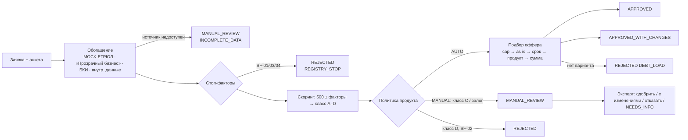

# Скоринг и модель кредитного решения (D6)
Статус: готов · Версия: 1.0 · Обновлено: 2026-10-24
Связано с: R-04, R-18, R-22, R-24 · JTBD-5, JTBD-6 · P-C4, P-B2, P-B5 · конфиг [`config/scoring_rules.yaml`](../../config/scoring_rules.yaml), эталон [`tools/reference/engine.py`](../../tools/reference/engine.py)

## Решение в одном абзаце
Решение принимается в три независимых слоя (PDF, с. 14–15: «скоринг ≠ решение»): **стоп-факторы** → **скоринг** (сумма баллов → класс риска A–D, не зависит от продукта) → **кредитная политика продукта** (по классу, сумме, сроку и долговой нагрузке выбирает один из пяти исходов и при необходимости подбирает контроффер). Модель — прозрачная балльная карта на правилах, а не ML: обучающих данных нет, а объяснимость клиенту и аудиту важнее точности на демо. Все веса и пороги — конфиг с версией, которая пишется в каждый результат. Эталонная реализация на Python посчитала все ожидаемые исходы seed-компаний — расчёты ниже не «от руки».

## 1. Конвейер решения



## 2. Стоп-факторы `[ДОПУЩЕНИЕ]`

| Код | Условие | Источник | Переход | Текст клиенту |
| --- | --- | --- | --- | --- |
| SF-01 | Компания ликвидирована / ликвидируется / банкротство | `[MOCK ЕГРЮЛ]` | T9 | «По данным реестра компания ликвидируется или находится в процедуре банкротства» |
| SF-02 | Текущая просрочка > 90 дней | `[MOCK БКИ]` | T15 | «Есть текущая просрочка по кредитам больше 90 дней» |
| SF-03 | Зарегистрирован < 3 мес. назад | `[MOCK ЕГРЮЛ]` | T9 | «Бизнес зарегистрирован менее 3 месяцев назад» |
| SF-04 | Руководитель/учредитель дисквалифицирован | `[MOCK «Прозрачный бизнес»]` | T9 | «Руководитель или учредитель числится в реестре дисквалифицированных лиц» |

SF-01 дополнительно проверяется уже на шаге ИНН (S-05): если реестр вернул статус ликвидации, UI не даёт продолжить. Серверная проверка T9 остаётся защитой от прямых вызовов API.

## 3. Скоринговая карта (база 500 баллов)
Направления влияния — по PDF, с. 14: стабильность и хорошая история снижают риск (плюс баллы), долговая нагрузка, нестабильность и просрочки повышают риск (минус баллы). Веса синтетические.

| Фактор | Значение → баллы | Почему такое направление |
| --- | --- | --- |
| Срок деятельности | < 1 года −40 · 1–3 года 0 · > 3 лет +40 | Стабильность бизнеса (с. 14) |
| Годовая выручка (анкета) | < 10 млн −20 · 10–60 млн +10 · > 60 млн +30 | Масштаб и запас прочности |
| Динамика выручки г/г | падение > 20% −40 · ±20% 0 · рост > 20% +25 | «Нестабильные финансовые показатели» (с. 14) |
| Долговая нагрузка* | > 50% −80 · 30–50% −20 · < 30% +30 | «Высокая долговая нагрузка» (с. 14) |
| Кредитная история `[MOCK БКИ]` | просрочки 30–90 дн. за 12 мес. −100 · 1–29 дн. −30 · нет просрочек +50 · нет истории 0 | Платёжная дисциплина (с. 13–14) |
| Запросы в БКИ за 30 дней | > 5 −30 · ≤ 5 0 | Признак срочного поиска денег |
| Отрасль (ОКВЭД) | повышенного риска −30 · обычная 0 · низкого риска +15 | Отраслевой риск |
| Расхождения анкеты и реестра (наименование, адрес, ОКВЭД, руководитель) | есть −25 · нет 0 | Достоверность данных |
| Клиент банка `[ДОПУЩЕНИЕ]` `[MOCK внутр. данные]` | р/с > 6 мес. +30 · иначе 0 | Банк видит обороты — меньше неопределённость |

\* **Долговая нагрузка** = (платежи по текущим кредитам в месяц + платёж по новому кредиту) / среднемесячная выручка. На этапе скоринга новый платёж считается по **базовой** ставке продукта на запрошенные сумму и срок (класс ещё неизвестен). Для кредитной линии платёж = проценты на весь лимит в месяц `[ДОПУЩЕНИЕ]`.
ОКВЭД повышенного риска: 41.\*, 42.\*, 49.41, 68.\*, 92.\*; низкого риска: 62.\*, 85.\*, 86.\*, 47.73 `[ДОПУЩЕНИЕ]`.

**Классы риска:** A ≥ 600 · B 520–599 · C 440–519 · D < 440.

## 4. Кредитная политика (матрица решений)

| Класс | «Экспресс-оборотка» | «Инвест-кредит» | «Кредитная линия» |
| --- | --- | --- | --- |
| A | AUTO, cap 5 млн | MANUAL_REVIEW (`COLLATERAL`) | AUTO, cap 10 млн |
| B | AUTO, cap 3 млн | MANUAL_REVIEW (`COLLATERAL`) | AUTO, cap 5 млн |
| C | MANUAL_REVIEW (`GREY_ZONE`) | MANUAL_REVIEW | MANUAL_REVIEW |
| D | REJECTED | REJECTED | REJECTED |

`cap` — максимальная сумма, которую политика одобряет автоматически для класса. Один и тот же класс B даёт разные исходы: «Экспресс» до 3 млн — сразу, «Инвест» — только через эксперта, «Линия» — до 5 млн (PDF, с. 14: одинаковая оценка → разные условия).

## 5. Подбор оффера для маршрута AUTO (детерминированный)
Шаги выполняются по порядку, первый успешный определяет исход. Лимит нагрузки — 50%, ставка — с надбавкой за класс, суммы округляются вниз до 50 000 ₽.

| Шаг | Что делаем | Исход | `changeType` |
| --- | --- | --- | --- |
| 1 CAP_BY_CLASS | Кандидат = min(запрошено, cap класса) | — | — |
| 2 FIT_AS_IS | Нагрузка кандидата на запрошенный срок ≤ 50% | APPROVED, если кандидат = запрошено; иначе APPROVED_WITH_CHANGES | NONE / AMOUNT |
| 3 EXTEND_TERM | Минимальный срок ≤ max_term продукта, при котором нагрузка ≤ 50% (только аннуитет) | APPROVED_WITH_CHANGES | TERM (+AMOUNT, если сработал cap) |
| 4 ALTERNATIVE_PRODUCT | Продукт из `alternatives` (EXPRESS ↔ LINE) с маршрутом AUTO покрывает запрошенную сумму (с его cap) при нагрузке ≤ 50% | APPROVED_WITH_CHANGES | PRODUCT |
| 5 REDUCE_AMOUNT | Максимальная сумма на max_term при нагрузке ≤ 50%, не меньше min_amount | APPROVED_WITH_CHANGES | AMOUNT (+TERM) |
| 6 REJECT | Ни один вариант не подходит | REJECTED, `DEBT_LOAD` | — |

Почему такой порядок: сначала сохраняем **сумму**, которая нужна клиенту под задачу (срок, затем другой продукт), и только потом урезаем сумму. Это прямо отвечает на страх «одобрят меньше, чем нужно» (P-C4) и показывает небинарный итог (PDF, с. 15).
Для маршрута MANUAL система считает тем же алгоритмом **рекомендованный оффер** (без cap) и предзаполняет им панель решения эксперта.

**Ставка** `[ДОПУЩЕНИЕ]`: базовая ставка продукта + надбавка класса (A +0 п.п., B +2, C +4).
**Платёж** — аннуитет:

```latex
PMT = S \cdot \frac{r}{1 - (1 + r)^{-n}}, \quad r = \frac{\text{ставка}}{12 \cdot 100}
```

Для кредитной линии: PMT = S · ставка / 1200 (проценты при полном использовании лимита). Переплата = PMT · n − S (линия: PMT · n).

## 6. Объяснимость

`ScoringResult` хранит: `score`, `riskClass`, `rulesVersion`, `debtLoad`, `factors[{code, value, points, clientText, expertText}]`, `stopFactors[]`, `createdAt`.

| Кому | Что видит | Правило отбора |
| --- | --- | --- |
| Клиент | 1 фраза «почему такое решение» + топ-3 фактора без баллов + «что можно сделать» | Отказ/контроффер: сначала факторы с наибольшим минусом; одобрение: с наибольшим плюсом. Факторы с 0 баллов не показываются |
| Эксперт | Все факторы с баллами и значениями, класс, версия правил, история скорингов, рекомендованный оффер | Полный список |
| Аудит | Decision + ScoringResult + rulesVersion + автор | Неизменяемая запись |

Фраза «почему» по исходу:

| Исход / шаг | Фраза клиенту |
| --- | --- |
| CAP_BY_CLASS | «По результатам оценки мы можем сразу одобрить до {cap} ₽» |
| EXTEND_TERM | «С более длинным сроком платёж будет комфортнее для бюджета бизнеса» |
| ALTERNATIVE_PRODUCT | «Под ваши регулярные разрывы лучше подходит {продукт}: платите проценты только за использованную часть» |
| REDUCE_AMOUNT | «Чтобы платёж не превышал половину среднемесячной выручки, мы предлагаем {сумма} ₽» |
| REJECTED (класс D) | «Сейчас риск по заявке выше, чем мы можем принять» + «Что можно сделать: снизить нагрузку, закрыть просрочки, подать через 3 месяца» |
| REJECTED (DEBT_LOAD) | «Даже минимальная сумма продукта сделает платёжную нагрузку слишком высокой» |
| REJECTED (стоп-фактор) | Текст стоп-фактора из §2 |

## 7. Ожидаемые результаты по seed-компаниям
Посчитано `python3 tools/reference/expected_outcomes.py --as-of 2026-10-24`. Финансовые параметры — [test_data](../testing/test_data.md).

| ID | Факторы (ненулевые) | Баллы | Класс | Нагрузка | Исход системы | Оффер / маршрут |
| --- | --- | --- | --- | --- | --- | --- |
| C1 | выручка +10, нагрузка −20, история +50, клиент банка +30 | **570** | B | 38,3% | APPROVED_WITH_CHANGES (T13, CAP_BY_CLASS) | Экспресс **3 000 000 ₽ / 12 мес. / 24%**, платёж 283 679 ₽, переплата 404 145 ₽, нагрузка после 32,2% |
| C2 | срок +40, выручка +30, динамика −40, нагрузка −80, история −100, запросы −30, отрасль −30 | **290** | D | 52,7% | REJECTED (T15, класс D) | Топ-3: просрочки, нагрузка, падение выручки |
| C3 | срок +40, выручка +10, динамика +25, нагрузка +30, история +50 | **655** | A | 17,6% | MANUAL_REVIEW (T14, COLLATERAL) | Рекомендация эксперту: Инвест 12 000 000 ₽ / 48 мес. / 19%, платёж 358 801 ₽ |
| C4 | выручка −20, нагрузка −20, расхождение −25, клиент банка +30 | **465** | C | 47,0% | MANUAL_REVIEW (T14, GREY_ZONE) | Рекомендация: 1 000 000 ₽ / 12 мес. / 26%, платёж 95 530 ₽ |
| C4′ | после ответа на запрос (адрес подтверждён): расхождение 0 | **490** | C | 47,0% | MANUAL_REVIEW (повторно) | Эксперт решает (E2E-04: 700 000 ₽ / 18 мес.) |
| C5 | — | — | — | — | REJECTED (T9, SF-01) | UI блокирует на шаге ИНН |
| C6 | — | — | — | — | MANUAL_REVIEW (T10, INCOMPLETE_DATA) | БКИ: 3 ретрая → таймаут |
| C7 | срок +40, выручка +30, нагрузка −80, история +50 | **540** | B | 62,8% | APPROVED_WITH_CHANGES (T13, ALTERNATIVE_PRODUCT) | **Кредитная линия 5 000 000 ₽ / 12 мес. / 23%**, проценты 95 833 ₽/мес., нагрузка после 49,6% |

Как получился C7: cap B для «Экспресса» = 3 млн; на 6 мес. нагрузка 56,9%, даже на 24 мес. — 50,6% (> 50%) → шаг 4: линия на 5 млн даёт 49,6% → `PRODUCT`.

**Юнит-кейсы для стоп-факторов без seed-компании** (dev добавляет в автотесты):

| Кейс | Вход | Ожидаемо |
| --- | --- | --- |
| U-SF02 | БКИ `current_overdue_days = 120`, класс по баллам B | REJECTED, `STOP_FACTOR`, SF-02 |
| U-SF03 | `registration_date` = as_of − 2 мес. | REJECTED (T9), SF-03 |
| U-SF04 | `persons[0].disqualified = true` | REJECTED (T9), SF-04 |
| U-REDUCE | Экспресс 5 млн / 12 мес., класс A, выручка 30 млн, текущие платежи 1 170 000 ₽/мес. (линия на 5 млн не помещается) | APPROVED_WITH_CHANGES, AMOUNT+TERM: 1 500 000 ₽ / 24 мес., нагрузка 49,9% |
| U-DEBT | Экспресс 1 млн, класс B, выручка 12 млн, текущие платежи 500 000 ₽/мес. (нагрузка уже 50%) | REJECTED, `DEBT_LOAD` |

## 8. Где уместен ИИ (Could, только open-weights)
Модель: Qwen2.5-7B-Instruct (Apache-2.0, ≈ 5 ГБ RAM в q4), на слабом ПК — Qwen2.5-1.5B-Instruct (Apache-2.0); локально через Ollama (огр. 08, огр. 02 — без платных API). Qwen2.5-3B не используем: у неё исследовательская лицензия, не Apache. По умолчанию `LLM_ENABLED=false`.

| Сценарий | Вход LLM | Выход | Фолбэк при выключенной/упавшей модели |
| --- | --- | --- | --- |
| Объяснение решения клиенту | Исход, оффер, топ-факторы (`clientText`), без ПДн | 2–3 предложения простым языком | Шаблон «фраза почему + топ-3 + что сделать» (§6) |
| Сводка заявки для эксперта | Анкета, факторы, расхождения, флаги | 5 пунктов «на что обратить внимание» | Список факторов с наибольшим |баллом| и флаги |
| Подбор продукта по свободному описанию | Текст клиента | Цель из справочника `purposes` | Выбор цели кнопками в мастере |

Правила: ИИ **никогда** не принимает и не меняет кредитное решение; ответ модели проходит проверку (нет чисел, которых нет во входе; длина ≤ 600 символов), иначе — фолбэк; таймаут 5 с.

## Допущения
- [ДОПУЩЕНИЕ] Веса, пороги, cap, надбавки, списки ОКВЭД, модель нагрузки линии — синтетика для демонстрации логики.
- [ДОПУЩЕНИЕ] В отличие от ТЗ (T14 «сумма > лимита авто-решения → эксперт»), превышение cap класса ведёт к автоматическому контрофферу (шаг 1–2): так требует сама матрица («больше → APPROVED_WITH_CHANGES»), и это разгружает эксперта (P-B2).

## Имитации
- [MOCK] ЕГРЮЛ/ЕГРИП, «Прозрачный бизнес», БКИ, внутренние данные — сервис моков; смысл интеграций сохранён (см. [02_mvp_scope §5](../product/02_mvp_scope.md)).

## Открытые вопросы
- Нет.

## DoD
- [x] Стоп-факторы, карта, классы, матрица по продуктам, правило контроффера, формат объяснения
- [x] Для каждой тестовой компании посчитан ожидаемый балл и исход (эталонным кодом)
- [x] ИИ — только Could, open-weights, с фолбэком
