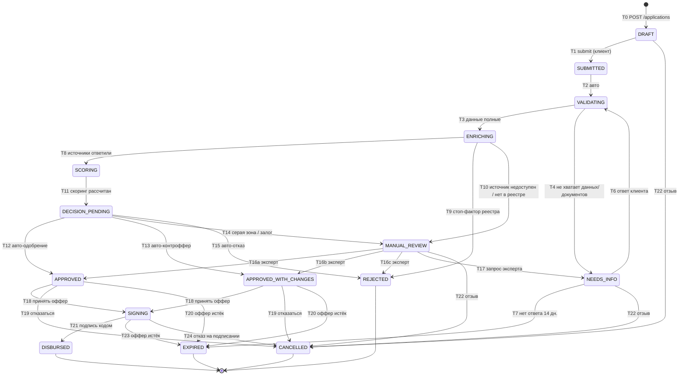

# Диаграмма состояний заявки (D5)
Статус: готов · Версия: 1.1 · Обновлено: 2026-10-24
Связано с: R-02, R-04, R-05, R-24 · JTBD-3, JTBD-4, JTBD-7 · P-C2, P-B1, P-B3, P-B5, P-B7 · используется в [screens](../ux/screens.md), [news_feed_rules](../product/news_feed_rules.md), [test_scenarios](../testing/test_scenarios.md), [api_overview](../api/api_overview.md)

## Решение в одном абзаце
Жизненный цикл заявки — конечный автомат из **15 статусов и 24 переходов**. Это единственный источник статусов для UI, API, БД, ленты и тестов: любой переход вне таблицы отклоняется `409 INVALID_TRANSITION`. Автоматические шаги (проверка, обогащение, скоринг, решение) идут сами с видимой паузой, ручные — только по действию клиента или эксперта. Каждый нетерминальный статус имеет выход (нет тупиков): у ожиданий клиента есть таймер `EXPIRED` и отзыв `CANCELLED`. Клиент видит не 15 технических статусов, а 6 понятных шагов.

## 1. Диаграмма

## 2. Статусы

| Статус | Смысл | Кто действует | Тип | Шаг клиента | Заголовок для клиента | Пояснение клиенту | «Что дальше» |
| --- | --- | --- | --- | --- | --- | --- | --- |
| DRAFT | Черновик, автосохраняется | Клиент | Ручной | 1 Заявка | «Черновик» | Данные сохраняются автоматически | «Заполните оставшиеся шаги и отправьте заявку» |
| SUBMITTED | Отправлена, зафиксирован снимок анкеты | Система | Авто | 1 Заявка | «Заявка принята» | Мы получили заявку | «Проверим, всё ли заполнено, — это несколько минут» |
| VALIDATING | Проверка полноты и корректности (поля, документы по чек-листу) | Система | Авто | 2 Проверка данных | «Проверяем данные» | Смотрим, всё ли заполнено и приложено | «Если чего-то не хватит, мы напишем здесь» |
| NEEDS_INFO | Нужны данные/документы от клиента (InfoRequest) | Клиент | Ожидание | 2 или 3 (см. §5) | «Нужны уточнения» | Перечень того, чего не хватает, и комментарий специалиста | «Ответьте до {дата} — иначе заявка будет закрыта» |
| ENRICHING | Запросы в `[MOCK ЕГРЮЛ/ЕГРИП]`, `[MOCK «Прозрачный бизнес»]`, `[MOCK БКИ]`, внутренние данные | Система | Авто | 2 Проверка данных | «Проверяем данные о компании» | Сверяем сведения из открытых реестров и кредитной истории | «Ничего делать не нужно» |
| SCORING | Расчёт баллов и класса риска | Система | Авто | 3 Оценка | «Оцениваем заявку» | Оцениваем финансовое положение бизнеса | «Обычно до {sla продукта}» |
| DECISION_PENDING | Кредитная политика продукта применяется к скорингу | Система | Авто | 3 Оценка | «Оцениваем заявку» | (как SCORING) | (как SCORING) |
| MANUAL_REVIEW | Рассмотрение кредитным экспертом | Эксперт | Ручной | 3 Оценка | «Заявку рассматривает специалист» | Для этой заявки нужна экспертная оценка | «Ожидаемое время — до {sla}. Специалист может запросить уточнения» |
| APPROVED | Одобрено на запрошенных условиях, оффер выдан | Клиент | Ожидание ответа | 4 Решение | «Одобрено» | Условия совпадают с запрошенными | «Примите предложение до {expiresAt}» |
| APPROVED_WITH_CHANGES | Одобрено на иных условиях: сумма, срок или другой продукт | Клиент | Ожидание ответа | 4 Решение | «Есть предложение» | Что изменилось и почему — одной фразой | «Сравните условия и примите до {expiresAt}» |
| REJECTED | Отказ | — | Финал | 4 Решение | «Не одобрено» | Топ-3 причины простыми словами | «Что можно сделать и когда подать снова» |
| SIGNING | Оффер принят, подписание (имитация) | Клиент | Ручной | 5 Подписание | «Подписание» | Проверьте договор и подтвердите кодом на экране | «Подпишите до {expiresAt}» |
| DISBURSED | Средства «выданы», кредит и график созданы | — | Финал | 6 Выдача | «Кредит выдан» | Деньги зачислены на счёт (демо) | «Ближайший платёж {дата} — {сумма}» |
| CANCELLED `[ДОПУЩЕНИЕ]` | Отозвана клиентом или отказ от оффера | — | Финал | шаг, где остановилась | «Заявка отменена» | Вы отозвали заявку / отказались от предложения | «Можно подать новую заявку» |
| EXPIRED `[ДОПУЩЕНИЕ]` | Истёк срок ответа на запрос или оффер | Система | Финал | шаг, где остановилась | «Срок истёк» | Мы не получили ответ вовремя | «Подайте новую заявку — данные компании подставятся сами» |

Зачем `CANCELLED` и `EXPIRED`: без них у NEEDS_INFO, офферов и SIGNING нет выхода — state machine незамкнута.

## 3. Таблица переходов

| # | Из | В | Триггер | Инициатор | Условие (guard) | Побочные эффекты |
| --- | --- | --- | --- | --- | --- | --- |
| T0 | — | DRAFT | `POST /applications` | Клиент | Пользователь — участник компании; продукт выбран | Черновик, `version = 1` |
| T1 | DRAFT | SUBMITTED | `POST /applications/{id}/submit` + `Idempotency-Key` | Клиент | Обязательные поля всех шагов валидны; суммы/срок в лимитах продукта; согласия на обработку данных и запрос в БКИ даны; **нет другой активной заявки компании на тот же продукт** (иначе `409 DUPLICATE`, заявка остаётся DRAFT) | Снимок анкеты (`snapshot`), audit, STATUS-карточка ленты |
| T2 | SUBMITTED | VALIDATING | Событие `application.submitted` | Система | — | audit |
| T3 | VALIDATING | ENRICHING | Валидация пройдена | Система | Все документы из `required_documents` продукта загружены и в статусе UPLOADED/ACCEPTED; все пункты закрытых InfoRequest учтены | audit |
| T4 | VALIDATING | NEEDS_INFO | Валидация не пройдена | Система | Не хватает документа или поле некорректно | InfoRequest (`createdBy = SYSTEM`) с перечнем; ACTION-карточка ленты; уведомление in-app |
| T6 | NEEDS_INFO | VALIDATING | `POST /applications/{id}/info-response` | Клиент | Все пункты InfoRequest закрыты (файл загружен / поле заполнено) | InfoRequest → ANSWERED; audit; новый снимок анкеты |
| T7 | NEEDS_INFO | EXPIRED | Таймер | Система | Нет ответа `INFO_REQUEST_TTL` (по умолчанию 14 дн.) | InfoRequest → EXPIRED; уведомление |
| T8 | ENRICHING | SCORING | Все обязательные источники ответили | Система | ЕГРЮЛ/ЕГРИП и БКИ = OK; «Прозрачный бизнес» — опционален (при сбое — пометка в карточке) | EnrichmentResult по каждому источнику |
| T9 | ENRICHING | REJECTED | Стоп-фактор реестра | Система | SF-01 (ликвидация/банкротство), SF-03 (< 3 мес.), SF-04 (дисквалификация) | Decision `REGISTRY_STOP`, причины клиенту |
| T10 | ENRICHING | MANUAL_REVIEW | Обязательный источник недоступен после 3 ретраев **или** ИНН не найден в реестре | Система | Таймаут/ошибка мока (C6) либо `404` реестра | Флаг `incompleteData`, причина `INCOMPLETE_DATA` в очереди |
| T11 | SCORING | DECISION_PENDING | Скоринг рассчитан | Система | — | ScoringResult (баллы, класс, факторы, `rulesVersion`); предыдущие результаты сохраняются |
| T12 | DECISION_PENDING | APPROVED | Авто-решение | Система | Маршрут AUTO, запрошенная сумма ≤ cap класса и нагрузка с новым платежом ≤ 50% | Decision `SYSTEM`, Offer `changeType = NONE` |
| T13 | DECISION_PENDING | APPROVED_WITH_CHANGES | Авто-контроффер | Система | Маршрут AUTO, но сработал cap класса или нагрузка > 50% → шаги подбора дали вариант (срок / другой продукт / меньшая сумма) | Offer с `changeType` и `changes[]` |
| T14 | DECISION_PENDING | MANUAL_REVIEW | Маршрут MANUAL | Система | Класс C, или продукт с залогом (INVEST) | Причина `GREY_ZONE` / `COLLATERAL`; рекомендованный оффер для эксперта |
| T15 | DECISION_PENDING | REJECTED | Авто-отказ | Система | Класс D, или SF-02 (текущая просрочка > 90 дн.), или ни один вариант подбора не укладывается в нагрузку 50% | Decision с `reasonCodes`, топ-3 причины клиенту |
| T16a/b/c | MANUAL_REVIEW | APPROVED / APPROVED_WITH_CHANGES / REJECTED | `POST /backoffice/applications/{id}/decision` | Эксперт | Комментарий обязателен для «с изменениями» и «отказ»; условия в лимитах продукта | Decision (`decidedBy = expertId`), Offer, audit с автором |
| T17 | MANUAL_REVIEW | NEEDS_INFO | `POST /backoffice/applications/{id}/info-request` | Эксперт | Перечень ≥ 1 пункта и комментарий | InfoRequest (`createdBy = expertId`); после ответа заявка проходит T6 → T3 → T8 → T11 заново |
| T18 | APPROVED / APPROVED_WITH_CHANGES | SIGNING | `POST /applications/{id}/offer/accept` | Клиент | `now < offer.expiresAt` (иначе `409 OFFER_EXPIRED`) | Договор-заглушка, код подписи (6 цифр) |
| T19 | APPROVED / APPROVED_WITH_CHANGES | CANCELLED | `POST /applications/{id}/offer/decline` | Клиент | — | Причина отказа клиента (опц.) |
| T20 | APPROVED / APPROVED_WITH_CHANGES | EXPIRED | Таймер | Система | `OFFER_TTL` (по умолчанию 10 дн.) | Уведомление |
| T21 | SIGNING | DISBURSED | `POST /applications/{id}/sign` | Клиент | Код совпал (код показывается на экране, не SMS — огр. 05); ≤ 3 неверных попыток, затем новый код | Loan + график, STATUS-карточка, уведомление |
| T22 | DRAFT / NEEDS_INFO / MANUAL_REVIEW | CANCELLED | `POST /applications/{id}/cancel` | Клиент | Статус из списка | audit; заявка исчезает из очереди эксперта |
| T23 | SIGNING | EXPIRED | Таймер | Система | `now ≥ offer.expiresAt` | Уведомление |
| T24 | SIGNING | CANCELLED | `POST /applications/{id}/offer/decline` | Клиент | — | Причина (опц.) |

Номер T5 из ТЗ не используется: дубль блокируется на T1 (см. [05_decisions](../product/05_decisions.md#d-01)).

## 4. Правила для разработчика (фиксирует PM)
1. Переходы вне таблицы запрещены: `409 Conflict`, код `INVALID_TRANSITION`, статус и данные не меняются.
2. Каждый переход пишет `ApplicationEvent` (`fromStatus`, `toStatus`, `transition`, `actor`, `reason`, `createdAt`) — это audit log, источник таймлайна и триггер ленты/уведомлений.
3. Автоматические шаги в демо идут с видимой паузой `DEMO_STEP_DELAY_MS` (по умолчанию 3000).
4. Конкурентный доступ: optimistic locking по `version` (`409 VERSION_CONFLICT`); повторный `submit` с тем же `Idempotency-Key` возвращает тот же ответ.
5. Повторный проход после NEEDS_INFO сохраняет историю скорингов — эксперт видит «было 465 → стало 490».
6. Автоматический конвейер — фоновый воркер, а не HTTP-запрос клиента: `submit` отвечает `202 Accepted`, статус клиент получает через SSE/polling.
7. Ретраи источников: 3 попытки, экспоненциальная пауза 1 / 2 / 4 с, таймаут запроса 3 с.
8. Таймеры (T7, T20, T23) проверяются планировщиком раз в минуту; TTL задаются env (`INFO_REQUEST_TTL_MINUTES`, `OFFER_TTL_MINUTES`), для демо NEG-12 — укороченные.
9. Активной считается заявка в любом нетерминальном статусе, кроме DRAFT.

## 5. Отображение для клиента (6 шагов)

| Шаг | Название | Технические статусы |
| --- | --- | --- |
| 1 | Заявка | DRAFT, SUBMITTED |
| 2 | Проверка данных | VALIDATING, ENRICHING, NEEDS_INFO (если запрос от системы, T4) |
| 3 | Оценка | SCORING, DECISION_PENDING, MANUAL_REVIEW, NEEDS_INFO (если запрос эксперта, T17) |
| 4 | Решение | APPROVED, APPROVED_WITH_CHANGES, REJECTED |
| 5 | Подписание | SIGNING |
| 6 | Выдача | DISBURSED |

- NEEDS_INFO показывается **на том шаге, откуда пришёл запрос** — таймлайн не «откатывается» визуально, на шаге появляется жёлтая метка «Нужны уточнения».
- CANCELLED и EXPIRED фиксируют таймлайн на последнем пройденном шаге и показывают итоговую серую плашку.
- Шаги, которые заявка проходит автоматически, отмечаются по факту события с временем (`createdAt` события).

## Допущения
- [ДОПУЩЕНИЕ] CANCELLED, EXPIRED и переходы T23/T24 добавлены для замкнутости автомата.
- [ДОПУЩЕНИЕ] Отзыв (T22) разрешён только в статусах ожидания (DRAFT, NEEDS_INFO, MANUAL_REVIEW): в автоматических статусах заявка находится секунды, отзыв там создаёт гонки.
- [ДОПУЩЕНИЕ] TTL: запрос информации 14 дн., оффер 10 дн.

## Имитации
- [MOCK] Источники обогащения — сервис моков; подписание и выдача — имитация (огр. 06).

## Открытые вопросы
- Нет.

## DoD
- [x] Все статусы постановки + CANCELLED/EXPIRED
- [x] У каждого перехода есть триггер, инициатор, guard и побочный эффект
- [x] Нет тупиковых нетерминальных статусов (проверено: у каждого нетерминального ≥ 1 исходящий переход, у ожиданий — таймер и отмена)
- [x] Mermaid в синтаксисе `stateDiagram-v2` (рендерится на GitHub)
- [x] Клиентские тексты статусов зафиксированы и переиспользуются в UX и ленте
