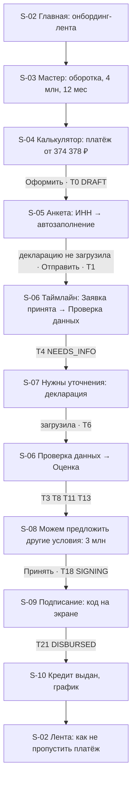
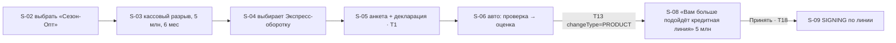
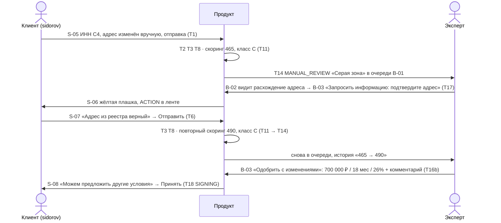
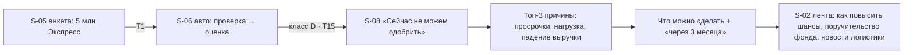
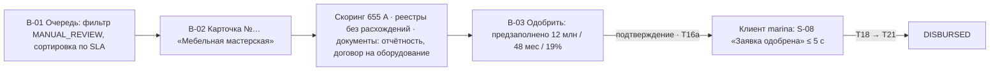

# UX: ключевые пользовательские потоки (D7, часть 2)
Статус: готов · Версия: 1.0 · Обновлено: 2026-10-24
Связано с: [screens](screens.md) · [state_machine](../process/state_machine.md) · [test_scenarios](../testing/test_scenarios.md)

## Решение в одном абзаце
Пять потоков покрывают все пять исходов решения и обе стороны процесса. Каждый поток = один E2E-сценарий и один блок демо, поэтому команда тестирует ровно то, что показывает. Справа от экранов — статусы state machine, чтобы фронт и бэк видели одно и то же.

## Поток 1. Счастливый путь «Экспресс-оборотка» с запросом информации и контроффером (anna / C1 → E2E-01)

## Поток 2. Контроффер «другой продукт» (sidorov / C7 → E2E-05)

## Поток 3. Ручное рассмотрение с запросом эксперта (sidorov / C4 + expert → E2E-04)

## Поток 4. Отказ с объяснением и переход к альтернативе (igor / C2 → E2E-02)

Для класса D кнопка «Подобрать другой вариант» не показывается (OFFER классу D не предлагается); для REJECTED по `DEBT_LOAD` — показывается и ведёт в S-03 с предзаполненной целью.

## Поток 5. Эксперт: очередь → карточка → решение (expert + marina / C3 → E2E-03)

## DoD
- [x] Потоки 1–5 нарисованы, у каждого — учётка, компания, E2E и переходы
